# Bibliotheca Quest 📚
### *The Ultimate Library Simulation & Management Game*
**Programming Fundamentals — Semester Project (Fall 2026)**  
**FAST - National University of Computer and Emerging Sciences, Lahore**

---

## 👨‍💻 Project Information
* **Lead Developer:** Muhammad Talha (Project Lead & Core Architect)
* **Roll Number:** 26L-0755
* **Group:** 15
* **Framework:** SFML (Simple and Fast Multimedia Library) 3.1.0+ / C++20 Standard
* **Target Platforms:** Windows (Visual Studio 2022 / 2026), Linux, macOS

---

## 🚀 Executive Project Overview
**Bibliotheca Quest** is an interactive, top-down 2D GUI-based library tycoon and arcade simulation game built in **C++** using the **SFML framework**. 

Moving far beyond traditional command-line (CLI) management systems, this application transforms foundational computer science concepts—**composite data structures, static & dynamic bounded arrays, binary & linear search algorithms, quicksort & insertion sort, and binary file stream serialization (`std::fstream`)**—into active, real-time 2D gameplay mechanics.

In *Bibliotheca Quest*, the player assumes the role of **Head Librarian Talha**, managing a bustling 2D pixel-art library. The player navigates between categorized bookshelves, consults the interactive in-game computer catalog terminal, retrieves requested books, and issues loans at the checkout counter before incoming AI patrons lose their patience and trigger operational library failure.

---

## 🏛️ System Architecture

```mermaid
graph TD
    A[main.cpp / Project.cpp] --> B[GameEngine]
    B --> C[Multi-State Machine]
    C --> C1[MainMenuState]
    C --> C2[GameplayState]
    C --> C3[CatalogUIState]
    C --> C4[PauseState]
    C --> C5[GameOverState]
    C --> C6[LeaderboardState]
    
    B --> D[Catalog Engine]
    D --> D1["Binary Search O(log N)"]
    D --> D2["Linear Search O(N)"]
    D --> D3["QuickSort & InsertionSort"]
    
    B --> E[Binary File Manager]
    E --> E1["catalog.dat (Book Records)"]
    E --> E2["savegame.bin (Game State)"]
    E --> E3["scores.dat (Leaderboard)"]
    E --> E4["transaction.log (Audit Trail)"]
    
    B --> F[Entities & Simulation]
    F --> F1[Player Librarian Entity]
    F --> F2[AI Patron NPC Queue & State Machine]
    F --> F3[Loan Circulation Manager]
    F --> F4[2D Library Tilemap & Collision System]
    F --> F5[Catalog Terminal UI Overlay]
```



---

## ✨ Key Features & CS Concepts Implemented

### 1. Struct-Based Composite Architecture
Custom composite structs engineered for optimal memory alignment, cache locality, and binary I/O serialization:
* `Vector2D`: Lightweight 2D vector for spatial positions and velocities.
* `Book`: Fixed-buffer struct holding ISBN, Title, Author, Category, Shelf Location, Grid Coordinates, and Available Copies.
* `Shelf`: Categorized shelf entity (Fiction, Sci-Fi, Academic, Quiet Archive).
* `Patron`: AI NPC entity tracking lifecycle states, queue slots, patience timers, and dynamic book requests.
* `Player`: Librarian stats, position, score, day progression, and carrying inventory.
* `TransactionRecord` & `HighScoreRecord`: Persistent audit records.

### 2. Dual-Engine Search Algorithms
* **Binary Search ($O(\log N)$):** 
  Executes high-speed lookups on catalog records sorted by ISBN. Displays operation counters confirming execution in $O(\log N)$ steps.
* **Linear Search ($O(N)$):** 
  Case-insensitive substring search matching titles and authors across all active records, with dynamic multi-match indexing.

### 3. Persistent Binary File Handling (`std::fstream`)
* `catalog.dat`: Direct binary serialization and deserialization of 100+ book struct records.
* `savegame.bin`: Flushes player coordinates, inventory state, patron queues, and day progression.
* `scores.dat`: Stores high scores and Hall of Fame records.
* `transaction.log`: Appends time-stamped audit records for all loan and return events.

### 4. 2D Interactive SFML Rendering & Tilemap
* Top-down parquet oak floor tilemap.
* Distinct categorized bookshelves with signage banners: **FICTION**, **SCI-FI**, **ACADEMIC**, and **QUIET ARCHIVE**.
* Bookshelf spines dynamically rendered with colorful pixel-art book bindings.
* Service checkout counter with register and queue markings.
* Dedicated Computer Search Station.
* Reading study desks equipped with banker's lamps and open study books.
* Bounded collision map preventing entity pass-through on walls, shelves, and furniture.

### 5. AI Patron Simulation & Dynamic Queuing
* Patrons spawn and pathfind to the checkout counter, forming an orderly FIFO queue.
* Thought bubbles / dialogue balloons float above patrons: `FIND: "Title" / ISBN`.
* Real-time patience meters (Green $\rightarrow$ Yellow $\rightarrow$ Red) deplete over time.
* Serving the correct book awards **+150 Points**; losing a patron to impatience deducts **-50 Points**.
* If 5 patrons are lost, a **Library Operational Failure** is triggered!

### 6. Interactive In-Game Catalog Terminal UI
* Pressing **TAB** or walking to the Computer Desk opens a floating interactive modal.
* Text input fields for ISBN and Title searches.
* Clickable and shortcut-triggered buttons for **[BINARY SEARCH]** and **[LINEAR SEARCH]**.
* Results box reveals exact shelf coordinates, grid location, stock count, and algorithmic operations count.

---

## 🎮 Controls & Gameplay Guide

| Key / Input | Action |
| :--- | :--- |
| **W, A, S, D** / **Arrow Keys** | Move Librarian Talha across the library floor |
| **TAB** | Toggle the interactive **Catalog Terminal UI** overlay |
| **E** or **Spacebar** | Interact: Retrieve book from shelf / Issue book to patron at counter |
| **ESC** | Open Pause Menu / Save Game & Flush Binary Records |
| **Mouse Left Click** | Select search fields and click Binary/Linear Search buttons in Terminal |
| **Enter** | Confirm search in Terminal / Select menu options |

---

## 💻 Setup, Building & Installation

### Option 1: Microsoft Visual Studio (Recommended on Windows)
1. Ensure **SFML 3.1.0** (or 2.6+) is installed at `C:\SFML\SFML-3.1.0` (or update Include/Lib paths in Project Properties).
2. Open `Library_Managment_System.slnx` or `Library_Managment_System.vcxproj` in Visual Studio 2022 or 2026.
3. Select configuration **Debug** or **Release**, Platform **x64**.
4. Press **F5** or `Ctrl + F5` to compile and run!

### Option 2: Linux / macOS / CLI Compilation
Compile using any standard C++20 compiler linking SFML:
```bash
g++ -std=c++20 main.cpp GameEngine.cpp Catalog.cpp BinaryFileManager.cpp \
    LibraryMap.cpp Player.cpp PatronManager.cpp CatalogTerminalUI.cpp \
    LoanManager.cpp -o BibliothecaQuest \
    -lsfml-graphics -lsfml-window -lsfml-system -lsfml-audio
./BibliothecaQuest
```

---

## 📋 System Execution Example Logs

### Terminal Dual-Engine Search Log
```
[SFML CATALOG TERMINAL - BINARY SEARCH ENGINE]
Target ISBN: 1004
Search Status: MATCH FOUND (Executed in O(log N) operations)
Title   : Computer Systems: A Programmer's Perspective
Author  : Randal E. Bryant
Location: Shelf B3 [Grid: X=12, Y=4]
In Stock: 5 Copies
```

### Persistent Binary Save Execution Log
```
[FILE SYSTEM]: Flushing 100 'Book' struct records to binary file 'catalog.dat'...
[FILE SYSTEM]: Writing player stats, grid coordinates, and patron queues to 'savegame.bin'.
[FILE SYSTEM]: Save process completed successfully. Terminating SFML RenderWindow.
```

---

## 👥 Group Members & Acknowledgements
* **Muhammad Talha (26L-0755):** Project Lead, Architecture, Game Loop, Search Engines & GUI
* **Muhammad Noman:** Backend Logic, Structs, File Handling (`fstream`)
* **Muhammad Haris:** SFML Graphics, UI & Game Loop Integration
* **Institution:** FAST-NUCES Lahore — Department of Computer Science
* **Course:** Programming Fundamentals (Fall 2026)
